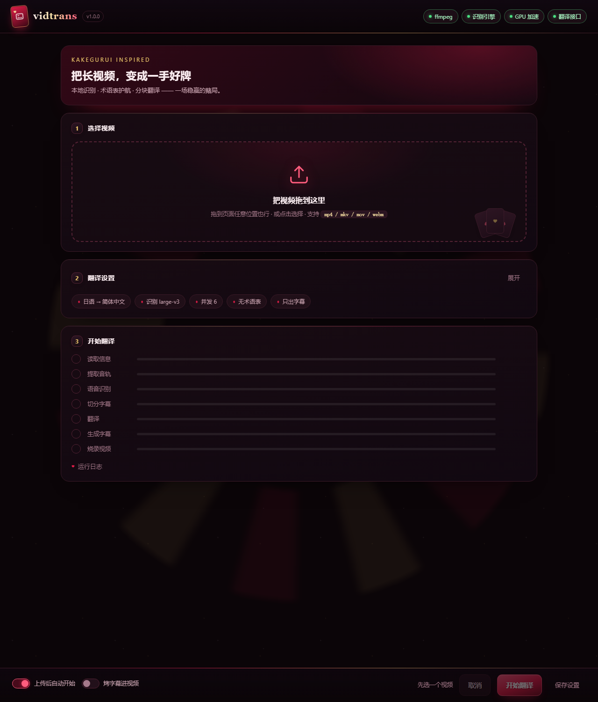

# vidtrans

[](https://github.com/Xie1Yuhe/vidtrans/actions/workflows/ci.yml)


**Turn long foreign-language videos into subtitles.** Runs locally, no per-minute ASR fees —
a 2-hour 1080p livestream is a single run.

> Built while subtitling a 2h24m Japanese game livestream: 2,661 cues, consistent terminology,
> zero timeline overlaps. Every gotcha we hit is baked into the pipeline.



```
video → extract audio → local ASR → smart splitting → chunked parallel translation → subtitles → (optional) burn-in
```

[中文说明](README.md) · [Contributing](CONTRIBUTING.md) · MIT License

---

## Features

- **Foolproof setup** — one-click ffmpeg installer, an API "test connection" button,
  and "auto-start after upload": drop a file and it just runs
- **Built for long videos** — 2h+ in one run (~3.5× realtime ASR on GPU)
- **Local ASR** — faster-whisper + CUDA, no per-minute billing; falls back to CPU automatically
- **Glossary** — `廻珠 → 回珠` style mapping injected into the translation prompt
- **Strict id alignment** — the model can't scramble your timeline
- **Auto re-ask** — missing ids are requested again in a second, smaller call
- **Preview before download** — first 40 cues are shown in the UI
- **Outputs** — SRT / bilingual SRT / styled ASS / zip bundle / burned-in MP4
- **Human-readable errors** — 401 / 429 / missing ffmpeg / no audio track, all explained
- **Zero third-party web deps** — stdlib HTTP server; install is just `faster-whisper`

---

## 30-second start

1. Double-click **`run.bat`** (Windows) or `./run.sh`
2. If the page says ffmpeg is missing, click **"一键安装 ffmpeg"** — it downloads and unpacks it for you
3. Pick a provider, paste your API key, click **"测试连接"** to verify

Then: **drop the video → wait → download the subtitles**.
"Upload then auto-start" is on by default, so dropping a file is the only action needed.

> ⚠️ **Don't double-click `vidtrans/web/index.html`.** That's `file://` — the page can't reach
> the backend and dropping a file just plays it. Start it with `run.bat` / `python app.py serve`.

---

## Quick start

### Requirements

| Need | Notes |
| --- | --- |
| Python 3.10+ | tick **Add Python to PATH** on Windows |
| ffmpeg / ffprobe | see below |
| An LLM API key | any OpenAI-compatible endpoint (DeepSeek, OpenAI, Ollama, …) |

**ffmpeg**: download `ffmpeg-release-essentials.zip` from <https://www.gyan.dev/ffmpeg/builds/>,
put `ffmpeg.exe` and `ffprobe.exe` into a `bin\` folder next to `app.py` — or install to PATH,
or set `VIDTRANS_FFMPEG=<dir containing ffmpeg.exe>`.

### Run

- **Windows**: double-click `run.bat` (installs deps on first run)
- **macOS / Linux**: `./run.sh` or `python app.py serve`

The console prints the URL (usually <http://127.0.0.1:8765/>) and opens your browser.

> ⚠️ **Do not open `vidtrans/web/index.html` by double-clicking it.** That's the `file://` protocol —
> the page can't reach the backend and dropping a file just plays it in the browser.

### Use

1. Drop a video into the page
2. Fill in API base URL / model / key
3. Click **开始翻译**
4. Download `.srt` / `.ass` / subtitled `.mp4`

---

## CLI

```bash
python app.py run input.mp4 --src ja --dst zh --model large-v3
python app.py run input.mp4 --glossary terms.txt --burn
python app.py run input.mp4 --mock            # validate the pipeline without any API call
python app.py serve --port 9000 --no-browser
```

After `pip install -e .`:

```bash
vidtrans run input.mp4 --src en --dst zh
```

---

## Glossary

This is what keeps terminology consistent. One mapping per line, `→` or `=` as separator:

```
廻珠 → 回珠
廻想残滓 → 回想残滓
ゾーン → ZONE          # not "domain/領域"
```

Separately, the **ASR prompt** is a vocabulary fed to the speech recognizer to fix proper nouns:

```
廻珠、廻想残滓、共闘キャラクター、黒閃、領域展開、虎杖悠仁、伏黒恵
```

---

## Configuration

Stored at `~/.vidtrans/config.json` (**the API key never leaves your machine**).

| Key | Default | Meaning |
| --- | --- | --- |
| `ffmpeg_dir` | empty | ffmpeg dir; or use `VIDTRANS_FFMPEG` |
| `asr_model` | `large-v3` | bigger = more accurate & slower |
| `asr_device` / `asr_compute` | `cuda` / `float16` | auto-falls back to `cpu` / `int8` |
| `asr_prompt` | empty | domain vocabulary |
| `provider.base_url` | `https://api.deepseek.com/v1` | any OpenAI-compatible API |
| `provider.model` | `deepseek-chat` | |
| `concurrency` | 6 | parallel translation chunks; lower it if rate-limited |
| `chunk_size` | 120 | cues per chunk |
| `max_chars_per_cue` | 36 | source chars per cue when splitting |
| `max_display_duration` | 8.0 | max on-screen seconds per cue |
| `max_line_chars` | 24 | chars per subtitle line |
| `glossary` / `extra_rules` | empty | glossary / extra translation instructions |
| `burn` | false | also output a subtitled video |

---

## Measured numbers

Source: 2h24m livestream, 1920×1080 @ 60fps.

| Stage | Time |
| --- | --- |
| ASR (large-v3 / CUDA / FP16) | 42 min |
| Split + translate + subtitle files | a few minutes |
| Burn-in (h264_nvenc) | ~35 min |
| Result | 2,661 cues, 0 overlaps, 0 terminology violations, 0 untranslated lines |

---

## FAQ

**Dropping a video just plays it in the browser** — the page was opened via `file://`.
Start it with `run.bat` / `python app.py serve` and open <http://127.0.0.1:8765/>.

**ffmpeg not found** — put it in `bin\`, or set `VIDTRANS_FFMPEG`.
Lookup order: config dir → env var → `bin\` → `tools\*\bin\` → PATH.

**`cublas64_12.dll` missing** — `pip install nvidia-cublas-cu12 nvidia-cudnn-cu12`,
or set `asr_device` to `cpu`.

**Model download stalls** — uses the `hf-mirror.com` mirror by default (`hf_endpoint`).

**401 / 403 from the API** — check key and that `base_url` includes `/v1`.

**429 rate limit** — lower `concurrency` to 2–3 and `chunk_size` to 60–80.

**Gaps in the subtitles** — instrumental/music-only sections are skipped by VAD. Expected.

---

## Testing

No network, GPU, or API key needed:

```bash
python -m compileall -q vidtrans app.py
node test/test_ui.js                          # front-end logic via DOM stub
python app.py run sample.mp4 --mock           # pipeline
python test/mock_api.py 8899 &                 # fake OpenAI endpoint
python app.py run sample.mp4 --base-url http://127.0.0.1:8899/v1 --api-key test
python app.py serve --port 8799 --no-browser &
python test/test_server.py http://127.0.0.1:8799 sample.mp4
```

---

## Roadmap

- [ ] **Browser-only build** — WebCodecs audio extraction + cloud ASR (Groq / OpenAI) +
      in-browser translation, deployable on GitHub Pages. Trade-off: not free, no burn-in.
- [ ] OCR for hardcoded on-screen text
- [ ] Speaker diarization
- [ ] Batch queue
- [ ] Multiple named glossaries

---

## License

[MIT](LICENSE)
