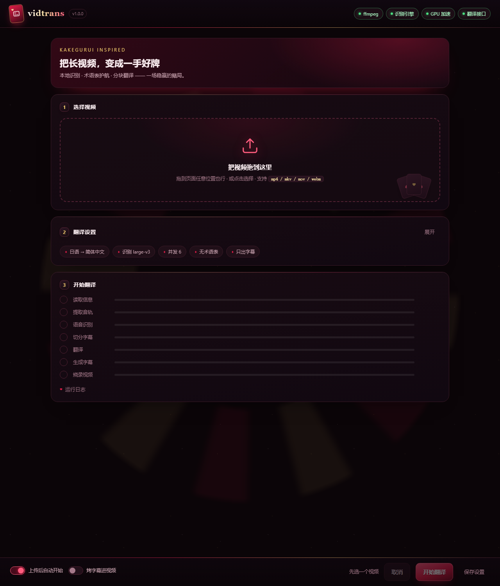

# vidtrans


**把长视频变成中文字幕。** 本地跑、不花识别费，2 小时 1080p 的直播也能一次跑完。

> 做这个的起因：给一场 2 小时 24 分的日服游戏前瞻直播做中文字幕，
> 全程 2,661 条字幕、术语一条没串、时间轴零重叠。踩过的坑都固化在这条流水线里了。



```
视频 → 抽音频 → 本地语音识别 → 智能切分 → 分块并行翻译 → 生成字幕 →（可选）烧录成片
```

[English](README.en.md) · [参与贡献](CONTRIBUTING.md) · MIT License

---

## 特性

- **傻瓜式上手**：页面上直接「一键安装 ffmpeg」、填 Key 后「测试连接」、勾上「上传后自动开始」——
  拖个视频进去就自己跑完了
- **长视频友好**：2 小时量级一次跑完（GPU 下识别约 3.5× 实时）
- **本地识别**：faster-whisper + CUDA，不按分钟付费；无显卡自动退 CPU
- **术语表**：`廻珠 → 回珠` 这种对照表注入翻译提示词，译名不会前后不一致
- **id 强对齐**：一行一条、按 id 回填，模型自由发挥也不会打乱时间轴
- **缺条自动补问**：某块少了几条，只对缺失部分再问一次
- **看得见的结果**：出片后先在页面上预览前 40 条字幕，确认没问题再下载
- **多种输出**：SRT / 双语 SRT / ASS（带样式）/ 打包 zip / 可烧录的 MP4
- **报错说人话**：401、429、没装 ffmpeg、视频没音轨…都会翻译成中文建议
- **零第三方 Web 依赖**：只用标准库起服务，装起来只要 `faster-whisper`

---

## 30 秒上手

1. 双击 **`run.bat`**（macOS / Linux 用 `./run.sh`）
2. 浏览器里如果提示缺 ffmpeg，点 **「一键安装 ffmpeg」**（自动下载解压，不用管）
3. 在「翻译用的 AI 接口」里选个服务商、粘贴 API Key，点 **「测试连接」** 确认通了

然后：**把视频拖进页面 → 等进度条走完 → 下载字幕**。
默认勾着「上传后自动开始」，所以拖进去就不用再点任何按钮。

> ⚠️ **不要直接双击 `vidtrans/web/index.html`**。那是 `file://` 协议，页面连不上后端，
> 拖视频会变成浏览器自己播放。请通过上面的方式启动，用控制台打印的地址访问。

---

## 界面

页面是「问题前置」的：能自动检测到的东西（ffmpeg 有没有、GPU 可用不可用、API 配没配）
都直接显示在顶部，缺什么就在最上面告诉你缺什么、怎么补。

```
顶栏    ffmpeg ✓   识别引擎 ✓   GPU 加速 ✓   翻译接口 ✓
        ↓（缺什么，下面就出现对应的补装/配置区块）
① 选择视频    拖拽即上传，自动显示缩略图
② 翻译设置    语言对（可一键交换）、识别模型、并发、烧录、术语表；收起时显示摘要
③ 开始翻译    7 个阶段的进度条 + 可展开的实时日志
④ 完成        统计信息 + 前 40 条字幕预览 + 一键下载
```

底部常驻操作条：`上传后自动开始` 开关 · 状态提示 · 取消 · **开始翻译** · 保存设置。

---

## 快速开始（手动版）

### 1. 准备

| 你需要 | 说明 |
| --- | --- |
| Python 3.10+ | 安装时勾选 **Add Python to PATH** |
| ffmpeg / ffprobe | 可以先不装，页面上点「一键安装」 |
| 一个 LLM API Key | 任何 OpenAI 兼容接口都行（DeepSeek、OpenAI、通义、Ollama…） |

### 2. 启动

**Windows**：双击 `run.bat`（首次会自动装依赖）。
**macOS / Linux**：`./run.sh` 或 `python app.py serve`。

控制台会打印地址，一般是 <http://127.0.0.1:8765/>，浏览器会自动打开。

> **如果没有 Python**，`run.bat` 会直接告诉你，并给四条解决办法：
> ① 装 python.org 的版本（记得勾 Add to PATH）；
> ② 关掉微软商店的 python 占位别名；
> ③ 下载便携版 Python 解压到本目录的 `.python\`（使 `.python\python.exe` 存在）；
> ④ 设环境变量 `VIDTRANS_PYTHON` 指向任意 `python.exe`。

### 3. 用起来

1. 拖视频进页面（或点击选择）
2. 选服务商 → 填 API Key → 点「测试连接」
3. 等进度条走完，下载 `.srt` / `.ass` / 带字幕的 `.mp4`

---

## 换主题 / 加自己的图

界面默认是**猩红 × 黑金**的赌场风格（轮盘、扑克牌、花色点缀），全部由 CSS 绘制，
不含任何第三方图片 —— 所以随便改。

想放自己的角色图：把图片存成 **`vidtrans/web/assets/yumeko.png`**，
刷新页面就会出现顶部主视觉；没有这张图时那块自动留白，不影响任何功能。
详见 [`vidtrans/web/assets/README.md`](vidtrans/web/assets/README.md)。

> 只用你有权使用的图片。第三方角色立绘请勿提交到公开仓库。

---

## 命令行

不装也能直接用：

```bash
python app.py run 视频.mp4 --src ja --dst zh --model large-v3
python app.py run 视频.mp4 --glossary 术语表.txt --burn
python app.py run 视频.mp4 --mock          # 不调 API，只验证管线通不通
python app.py serve --port 9000 --no-browser
```

装了（`pip install -e .` 或 `pip install .`）之后：

```bash
vidtrans run 视频.mp4 --src en --dst zh
```

主要参数：`--src --dst --model --asr-prompt --glossary --chunk-size --concurrency
--burn --outdir --ffmpeg-dir --base-url --api-key --model-name`

---

## 术语表怎么用

这是决定译名一致性的东西，强烈建议填。每行一条，`→` 或 `=` 分隔：

```
廻珠 → 回珠
廻想残滓 → 回想残滓
ゾーン → ZONE（不是「领域」）
潜在解放 → 潜在解放
```

会被当成「优先级最高的强制译法」写进翻译提示词。

**识别提示词**是另一件事：那是喂给语音识别模型的词表，用来纠正专有名词的听写错误。例如：

```
廻珠、廻想残滓、共闘キャラクター、共闘スキル、黒閃、領域展開、虎杖悠仁、伏黒恵
```

---

## 配置

存在 `~/.vidtrans/config.json`（**API Key 只在本机**）。

| 键 | 默认 | 说明 |
| --- | --- | --- |
| `ffmpeg_dir` | 空 | ffmpeg 目录；也可用环境变量 `VIDTRANS_FFMPEG` |
| `asr_model` | `large-v3` | 识别模型，越大越准越慢 |
| `asr_device` / `asr_compute` | `cuda` / `float16` | 无 GPU 自动退回 `cpu` / `int8` |
| `asr_prompt` | 空 | 领域提示词 |
| `provider.base_url` | `https://api.deepseek.com/v1` | 任何 OpenAI 兼容接口 |
| `provider.model` | `deepseek-chat` | |
| `provider.api_key` | 空 | |
| `concurrency` | 6 | 并行翻译分块数；被限流就调小 |
| `chunk_size` | 120 | 每块字幕条数 |
| `max_chars_per_cue` | 36 | 切分时单条源文字数上限 |
| `max_display_duration` | 8.0 | 单条字幕最长显示秒数 |
| `max_line_chars` | 24 | 每行译文字数 |
| `glossary` / `extra_rules` | 空 | 术语表 / 额外翻译要求 |
| `burn` | false | 是否同时输出带字幕视频 |

---

## 实测数据

素材：2 小时 24 分日服直播，1920×1080 / 60fps。

| 环节 | 耗时 |
| --- | --- |
| 语音识别（large-v3 / CUDA / FP16） | 42 分钟 |
| 切分 + 翻译 + 出字幕 | 几分钟 |
| 烧录成片（h264_nvenc） | 约 35 分钟 |
| 结果 | 2,661 条字幕，0 重叠、0 术语违规、0 未翻译残留 |

---

## 常见问题

**双击 `run.bat` 报一堆「'xxx' 不是内部或外部命令」**
说明 `run.bat` 被存成了 **UTF-8 + LF 换行**。Windows 的 cmd 只认 **CRLF 换行**，
而且它按系统码页（中文是 GBK）解析文件，遇到混合编码就会把命令行从中间截断。
本仓库的 `run.bat` 现在是**纯 ASCII + CRLF**，`.gitattributes` 里也锁了
`run.bat text eol=crlf`，正常 clone 下来不会出问题。
如果你自己改过这个文件，请确认保存为 **ANSI/ASCII + CRLF**。

**拖视频进去没反应，浏览器反而自己播放了**
页面是用 `file://` 双击打开的。用 `run.bat` / `python app.py serve` 启动，
访问 <http://127.0.0.1:8765/>。新版页面检测到 `file://` 会直接弹红条说明。

**语言下拉框点了没反应**
同理，多半是没连上后端。新版内置了 13 种语言的兜底表，正常情况下一定有选项。

**没装 ffmpeg**
不用自己折腾：页面顶部「音频工具 ffmpeg」那一行点 **「一键安装 ffmpeg」**，
会自动从 gyan.dev 下载并解出 `ffmpeg.exe` / `ffprobe.exe` 到项目 `bin\` 目录。
想手动装也可以，查找顺序是：配置目录 → `VIDTRANS_FFMPEG` 环境变量 →
项目 `bin\` → `tools\*\bin\` → PATH。

**API 连不通**
先点「测试连接」，它会真的发一次极小请求，把原因直接显示出来（Key 错、地址错、被限流）。
`base_url` 通常要带 `/v1`，例如 `https://api.deepseek.com/v1`。

**用哪家 API 便宜**
默认推荐 DeepSeek，页面上也内置了 OpenAI / 硅基流动 / Kimi / 本地 Ollama 的预设，
选一下就会自动填好地址和模型名。用 Ollama 可以完全离线、零费用。

**GPU 报缺 `cublas64_12.dll`**
```bash
pip install nvidia-cublas-cu12 nvidia-cudnn-cu12
```
程序会自动把这两个包的 DLL 目录挂进 PATH。还不行就把 `asr_device` 改成 `cpu`。

**模型下载卡住**
默认走 `https://hf-mirror.com` 镜像（配置项 `hf_endpoint`）。`large-v3` 约 3GB，之后本地缓存。

**翻译 401 / 403**
Key 或 base_url 不对。base_url 通常要带 `/v1`，例如 `https://api.deepseek.com/v1`。

**被限流 429**
`concurrency` 调到 2~3，`chunk_size` 调到 60~80。

**字幕有空白段**
纯音乐 / 无人声段落会被 VAD 跳过，这是正常的。

---

## 架构

```
app.py                  薄封装（python app.py ...）
run.bat / run.sh        一键启动
vidtrans/
  cli.py                命令行解析
  config.py             配置读写
  utils.py              子进程 / 时间 / ffmpeg 查找
  cuda.py               Windows CUDA DLL 挂载
  ffmpeg.py             抽音频、烧录
  asr.py                faster-whisper 封装
  segment.py            切分（日语助词/片假名保护）+ 分块
  translate.py          OpenAI 兼容并发翻译
  subtitle.py           SRT / ASS / 双语 + 时间轴规整
  pipeline.py           串联全流程
  server.py             标准库 HTTP + SSE
  web/index.html        单页界面（无框架）
test/                   自测脚本
```

几个刻意的设计：

- **不用 faster-whisper 自带的音频解码** —— 它对 PyAV 版本敏感，统一先用 ffmpeg 出 16k wav。
- **烧录时把 cwd 切到 ASS 所在目录** —— `ass=` 过滤器按 cwd 找文件，中文路径/换盘符都不炸。
- **前端单文件、无构建** —— 将来想搬到 GitHub Pages 也不用改构建链。

---

## 测试

都不需要联网、显卡、API Key：

```bash
python -m compileall -q vidtrans app.py
node test/test_ui.js                          # 前端逻辑（DOM 桩，无需浏览器）
python app.py run 你的短视频.mp4 --mock        # 管线
python test/mock_api.py 8899 &                 # 本地假 OpenAI 接口
python app.py run 短视频.mp4 --base-url http://127.0.0.1:8899/v1 --api-key test
python app.py serve --port 8799 --no-browser &
python test/test_server.py http://127.0.0.1:8799 短视频.mp4
```

---

## 路线图

- [ ] **纯浏览器版**：WebCodecs 抽音轨 + 云端识别（Groq / OpenAI Whisper）+ 浏览器内翻译，
      可直接部署到 GitHub Pages。代价是不再免费、且不能烧录。
- [ ] OCR 翻译画面上的硬字幕（幻灯片、PV 字幕）
- [ ] 说话人分离
- [ ] 批量队列（一次拖多个视频）
- [ ] 术语表多套保存、按项目切换

---

## License

[MIT](LICENSE)
